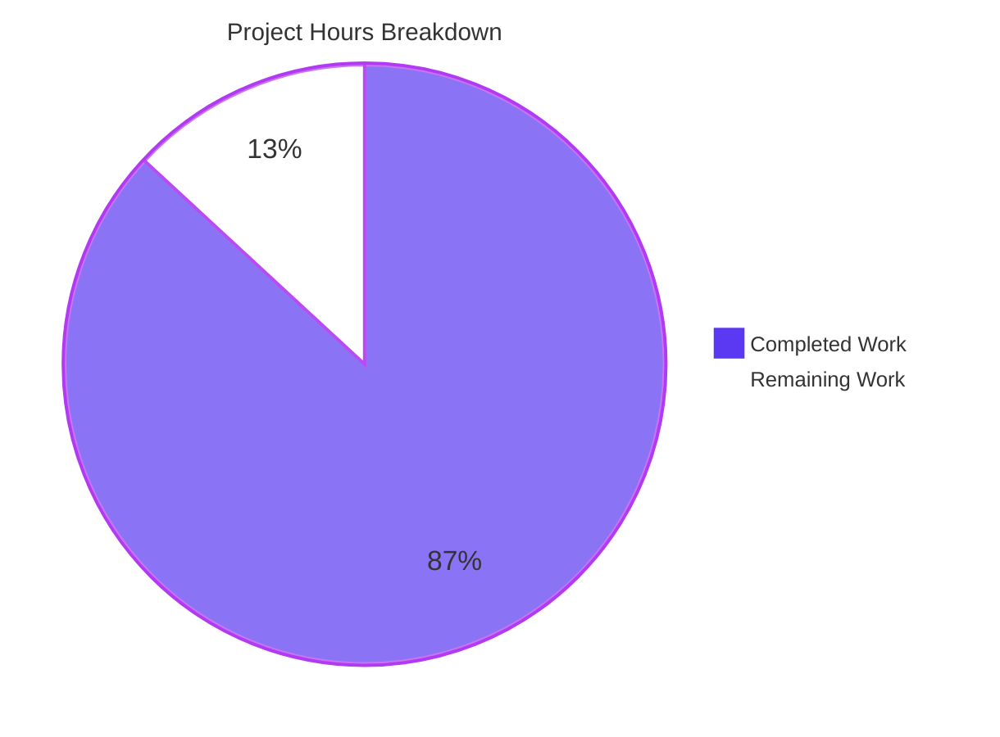
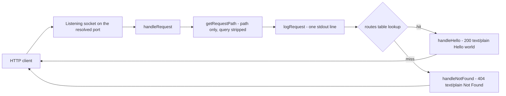

# 1. Executive Summary

## 1.1 Project Overview

A dependency-free Node.js HTTP server delivered as three files: `server.js` (the whole program), `package.json` and `README.md`. It answers `GET /hello` with `Hello world`, returns `Not Found` for everything else, logs one ISO-8601 line per request before routing, takes its port from `PORT` (default 3000, range 1024–65535), refuses privileged ports itself, and exits cleanly on `CTRL+C` with status 0. It is a framework-free reference a reader can start, call and read end to end.

## 1.2 Completion Status

**86.9% of the scoped work is delivered — 53 of 61 hours.** Everything specified is built and exercised; the rest is four decisions and coverage items for a human.



| Metric | Value |
|---|---|
| Total Hours | 61 |
| Completed Hours (AI + Manual) | 53 |
| Remaining Hours | 8 |
| **Percent Complete** | **86.9%** |

53 ÷ 61 × 100 = **86.9%**. Completed = Dark Blue `#5B39F3`; Remaining = White `#FFFFFF`.

## 1.3 Key Accomplishments

- ✅ `GET /hello` — `200`, `text/plain`, body exactly `Hello world`, over `127.0.0.1`, `localhost` and with a query string
- ✅ Every other method and path — `404` `Not Found`, never `405`
- ✅ One ISO-8601 request line per request before routing, query stripped from log and match
- ✅ `PORT` end to end: default, override, leading zeros, both bounds, both rejections with exit 1 and no socket
- ✅ Privileged ports refused by the application (port 80 never bound), both bind-failure forms caught with the holder still serving
- ✅ Clean `CTRL+C`: shutdown line, exit 0, repeats silent, idle sockets not delaying the exit
- ✅ 20 of 20 latency samples under 10 ms, 200 parallel requests all answered, memory flat over 1,000 requests
- ✅ Zero-install runnability through `node server.js` and `npm start`, in exactly three committed files

## 1.4 Critical Unresolved Issues

Of **16 scoped items, 4 carry an accepted caveat**; the other 12 are complete without reservation, and nothing here blocks release.

| Issue | Impact | Owner | ETA |
|---|---|---|---|
| Declared runtime floor `engines.node: >=18.0.0` (`package.json:10`, restated at `README.md:20`) names an end-of-life line that receives no security updates | An unsupported runtime is advertised as the supported minimum; the code itself runs unchanged on every later line | Maintainer | Next maintenance window — 3 h |
| The listener answers the IPv4 loopback address only, so a client that forces IPv6 against `localhost` is refused (`server.js:160`) | Confusing failure in an IPv6-only setup; every documented `localhost` URL still works because clients fall back to IPv4 | Maintainer | When an IPv6 requirement appears — 2 h |
| The idle-connection cleanup branch (`server.js:130`) has never run at runtime, because only Node 22 is available here | On Node 18.0.x/18.1.x the shutdown can wait out an idle keep-alive socket instead of exiting at once | Maintainer | With the floor decision — 2 h |
| Bind-error classes other than `EADDRINUSE` and `EMFILE` (`EACCES`, `EADDRNOTAVAIL`) have not been produced | The generic bind-failure line (`server.js:109-111`) is verified for one error code only | Maintainer | Next host that can provoke them — 1 h |

## 1.5 Access Issues

No access issues identified. Nothing external is required — no registry, credential, endpoint, datastore or repository permission — because the project makes no outbound request and reads one environment variable.

| System/Resource | Type of Access | Issue Description | Resolution Status | Owner |
|---|---|---|---|---|
| None | — | Nothing external is required: no package registry (no dependencies), no network egress (the only socket is the listener), no datastore and no secret | n/a | — |

## 1.6 Recommended Next Steps

1. **[High]** Choose the supported Node.js line and raise `engines.node` with the two README statements, then re-run the acceptance procedure — 3 h
2. **[High]** Re-run the procedure on that floor; on Node 18.0.x/18.1.x confirm shutdown does not wait on an idle socket — 2 h
3. **[Medium]** Decide IPv6 loopback reachability: bind `::1` alongside IPv4 at `server.js:160`, or record IPv4-only as deliberate — 2 h
4. **[Medium]** Provoke `EACCES` and `EADDRNOTAVAIL` and confirm the documented generic bind-failure line — 1 h
5. **[Low]** Keep the acceptance procedure as the gate; automate it only if the tutorial outgrows three files

# 2. Project Hours Breakdown

## 2.1 Completed Work Detail

Every row below traces to a requirement of the specification; the hours are engineering effort, including the verification each capability needed. The column sums to the 53 completed hours stated in Section 1.2.

| Component | Hours | Description |
|---|---|---|
| HTTP server core — request listener, route table, `GET /hello`, catch-all `404` | 6 | `http.createServer(handleRequest)`, the `'GET /hello'` route table as the single routing truth, `handleHello` (200 / `text/plain` / `Hello world`) and `handleNotFound` (404 / `Not Found`), with an unmatched method falling through as a plain table miss rather than a `405` |
| Per-request logging before routing | 2 | The path derived once and query-stripped (`getRequestPath`), written as one stdout line in `<ISO-8601 timestamp> <METHOD> <path>` form before the lookup, so log and match can never disagree |
| Startup confirmation and server initialization | 1 | The startup line emitted from the `listen` callback, the first moment the port is bound, and nothing written before it |
| `PORT` configuration, validation and privileged-port refusal | 5 | Default 3000 for unset, blank or whitespace-only values; digits optionally minus-signed; leading zeros accepted; the 1024–65535 range enforced; both rejection sentences built from the range constants and emitted before any socket exists, which is the only control that refuses a privileged port in a root container |
| Graceful `SIGINT` shutdown | 4 | One shutdown line, a guard so a second `CTRL+C` cannot log or close twice, `server.close()`, idle-connection cleanup behind a runtime guard, and an explicit exit with status 0 rather than Node's default `SIGINT` status |
| Bind-failure handling, both variants | 3 | The actionable `EADDRINUSE` line and the generic `Failed to bind port <port>: <code> - <message>` form for any other listen error, each on stderr with exit 1 and no stack trace, leaving the instance that holds the port untouched |
| Console-line delivery on every early-exit path | 4 | Each terminating line (both bind variants, the rejected-`PORT` line, the shutdown line) delivered from its stream write's completion callback, so a diagnostic cannot be lost when stdout or stderr is a pipe |
| `package.json` manifest | 1 | The seven fields with their exact values, `main` and `scripts.start` naming the same entry point, no dependency field and no `type` field, keeping the package CommonJS |
| `README.md` documentation set | 8 | The eight documented sections — purpose, prerequisites, installation, execution, testing, expected output, shutdown, `PORT` — with every example copied from the program's literal output, including both bind-failure forms and the runtime condition on the idle-connection cleanup |
| Security boundaries and error containment | 3 | No evaluation, filesystem access, child process, outbound client or persistence; input handling stops at comparing the path for equality, so no request value can reach a response, header, file path or command; the two bodies are literals and no diagnostic or configuration value is ever written to the wire |
| Zero-install, single-file minimalism | 1 | One CommonJS module with `node:http` as its only import and the route table as the only routing mechanism, so `node server.js` runs with no install step, lockfile or `node_modules` |
| Comment surface and code-quality compliance | 1 | Comments only where the logic is not obvious — the route-key construction, the port parse rule, the flush contract, the shutdown guard, the idle-cleanup guard and the loopback bind — with no comment restating the line beneath it, no unused variable and no dead code |
| End-to-end acceptance verification of the delivered behaviour | 14 | The full acceptance procedure run against the running application: both routes and every non-matching form, the log and stream contracts, latency sampling, the parallel-request run, the memory trend, every configuration case including the boundaries inside a private network namespace, both bind-failure forms, the start-stop cycle and its exit status, `npm start`, and the browser pass over the served text |
| **Total** | **53** | Completed hours, matching Section 1.2 |

## 2.2 Remaining Work Detail

Each row traces to a requirement of the specification or to a path-to-production need. The column sums to the 8 remaining hours stated in Section 1.2 and shown as "Remaining Work" in Section 7.

| Category | Hours | Priority |
|---|---|---|
| Runtime floor decision — raise the declared Node.js line off the end-of-life 18.x value, update `engines.node` and the two README statements, then re-run the acceptance procedure | 3 | High |
| Declared-floor verification — run the acceptance procedure on Node 18.0.x/18.1.x so the idle-connection cleanup fallback (`server.js:130`) is exercised on the minimum the repository advertises | 2 | High |
| IPv6 loopback decision — bind `::1` as well when a forced-IPv6 client must be served, or record IPv4-only reachability as deliberate, then re-verify the documented URLs | 2 | Medium |
| Remaining listen-error classes — provoke `EACCES` and `EADDRNOTAVAIL` and confirm the generic bind-failure form (`server.js:109-111`) and its documentation | 1 | Low |
| **Total** | **8** | — |

## 2.3 Estimation Basis

Completed hours use category bands rather than line counts: a single-module, event-driven HTTP service with a small, exactly specified contract, where the effort sits in byte-exact output, lifecycle guarantees and configuration validation rather than in volume. Verification is sized to the acceptance procedure the specification names as in-scope work, which for this project is the only verification that exists — there is no automated suite to absorb that effort — and is weighted at roughly a third of the delivered hours, the upper end of the usual band, because every observable is a literal string, a status code or an exit status that had to be confirmed on the running process. Remaining hours are estimates with high confidence: each of the four items is a decision plus a re-run of a procedure that already exists, and none requires new code unless a decision goes a particular way. Hours are stated to the whole hour and the two totals are reconciled in Sections 1.2, 2.1, 2.2 and 7.

# 3. Test Results

The project ships no automated test framework by design: its verification is the acceptance procedure executed against the running application, which is why the "Framework" column names the instrument used for each area rather than a test runner. Each row counts the discrete checks executed and their outcome; every check passed, and no coverage percentage is reported because no coverage tooling exists in this project.

| Area / Category | Framework | Tests | Passed | Failed | Coverage | What This Proves |
|---|---|---|---|---|---|---|
| Route contract — `GET /hello`, catch-all `404`, method semantics | `curl -si` + Node HTTP client | 7 | 7 | 0 | n/a | Both routes return their exact status, `Content-Type` and literal body, a query string does not change the match, and a wrong method on `/hello` is a `404` `Not Found` rather than a `405` |
| Request-log contract | stdout capture with line-format matching | 3 | 3 | 0 | n/a | Exactly one `<ISO-8601 Z> <METHOD> <path>` line per request, written before the route lookup, query stripped from both the log and the match — 1,220 lines for 1,220 requests, zero malformed |
| Console-line contract, startup and shutdown | separate stdout/stderr capture across process lifecycles | 3 | 3 | 0 | n/a | The startup line is the first output, the shutdown line the last, a repeated `CTRL+C` logs once, stdout is empty on a rejection and stderr is empty while the server serves |
| `PORT` configuration and rejection | process runs, boundaries inside a private network namespace | 8 | 8 | 0 | n/a | Default 3000 (unset and blank), the override, leading zeros and both boundaries accepted; every rejected value produces its exact sentence on stderr with exit 1 and empty stdout |
| Privileged-port refusal and bind-failure handling | netns process run, socket probe, second instance, descriptor-limited run | 4 | 4 | 0 | n/a | `PORT=80` is refused by the application with the privileged wording and port 80 is provably never bound; `EADDRINUSE` and a real `EMFILE` each reach the operator as the exact line with exit 1 while the holder keeps serving |
| Performance and resource gates | timing measurement, parallel driver, resident-set sampling | 3 | 3 | 0 | n/a | 20 of 20 samples under the 10 ms budget (maximum 3.1 ms), 200 parallel requests all answered `200` with one log line each, and memory flat (+756 KB) across 1,000 sequential requests |
| Entry points, install-free runnability and static gates | `node --check`, strict JSON parse, `git ls-files`, source sweep | 8 | 8 | 0 | n/a | `node server.js` and `npm start` both serve with no install step and no lockfile; the tracked tree is exactly the three deliverable files; the manifest carries the seven fields with no dependency or `type` field; `node:http` is the only import and the syntax gate exits 0 |
| Security boundaries, hostile input and listener scope | static construct sweep, 10 hostile requests, kernel socket table | 8 | 8 | 0 | n/a | No evaluation, filesystem access, child process, outbound client or persistence exists; only `req.method` and `req.url` are read and nothing is echoed back to a hostile or malformed path; the sole listening socket is on `127.0.0.1`, and the container IP receives no HTTP response at all |

**Not Covered**

- **No automated suite of any kind exists in this project** — the specification fixes the deliverable at three files and excludes test frameworks, an `npm test` script and a `tests/` directory. Every check above was executed by hand against the running process, so there is no coverage figure and no unit-test category; a maintainer who wants a regression net will need to build one deliberately, outside the specified deliverable.
- **The declared runtime floor was never executed.** Only Node 22.23.3 is installed here, so the idle-connection cleanup fallback (`server.js:130`) — the branch taken on Node 18.0.x/18.1.x, where `server.closeIdleConnections()` does not exist — is unexercised. A human should run the acceptance procedure on the declared minimum and watch the shutdown timing with an idle keep-alive socket held open.
- **Two listen-error classes were never produced.** Only `EADDRINUSE` (a busy port) and `EMFILE` (a descriptor limit) were provoked, so the generic bind-failure form is confirmed for one error code; `EACCES` and `EADDRNOTAVAIL` should be provoked on a host that can, and the emitted line compared with the documented form.
- **A forced-IPv6 client was not separately exercised.** The listener's reachability was confirmed against the container IP (no HTTP response at all) and over `127.0.0.1` and `localhost`; a client that resolves `localhost` to `::1` and refuses to fall back to IPv4 will be refused, which is the direct consequence of binding one address.
- **Documentation prose cannot be executed.** The statements in `README.md` are verified by reading them against the behaviour observed on the running server; the commands they describe are all executed, but the sentences themselves are not a test.

# 4. Runtime Validation & UI Verification

The product has no user interface: it serves two fixed plain-text bodies and ships no markup, styles, scripts or assets. Its observable surfaces are therefore the console lines and the HTTP responses, and both were driven directly against the running process — through `curl`, a Node HTTP client and a real headless Chrome session.

- ✅ **Startup** — `PORT=<port> node server.js` and `npm start` both bind and print `Server listening on port <port>` as the first output, with nothing written before it
- ✅ **`GET /hello`** — `200`, `Content-Type: text/plain`, `Content-Length: 11`, body exactly `Hello world`, rendered as the application's own text; driven over `127.0.0.1`, over `localhost`, and with a query string attached
- ✅ **Catch-all `404`** — `/invalid`, `/Hello`, `/hello/`, `/hello/anything` and `/` return `Not Found`, as do `POST`, `PUT`, `DELETE`, `PATCH`, `OPTIONS` and `HEAD` on `/hello` (never `405`), including a `POST` carrying a request body
- ✅ **Request logging** — one `<ISO-8601 Z> <METHOD> <path>` line per request before the route lookup, query stripped, with unmatched and non-GET requests logged identically
- ✅ **Configuration** — default 3000 for unset and blank values, an environment override, leading zeros resolving to the same integer, and both accepted boundaries 1024 and 65535
- ✅ **Failure paths** — both rejection sentences on stderr with exit 1 and no socket opened; `EADDRINUSE` and a real `EMFILE` on stderr with exit 1, while the instance holding the port kept serving
- ✅ **Shutdown** — `SIGINT` produces the shutdown line, exit status 0 and a released port; a repeated `CTRL+C` logs exactly one line; an idle keep-alive socket does not delay the exit
- ✅ **Performance and resources** — 20 of 20 samples under the 10 ms budget (maximum 3.1 ms), 200 parallel requests answered `200` with one log line each, resident memory flat (+756 KB) across 1,000 requests
- ✅ **Browser surface** — Chrome receives and renders the application's own plain text for both routes with zero page-originated console messages; the container IP returns no HTTP response at all, and Chrome's automatic `/favicon.ico` fetch is answered by the documented catch-all
- ⚠ **Not exercised at runtime** — Node 18.0.x/18.1.x, where the idle-connection cleanup fallback branch applies; the `EACCES` and `EADDRNOTAVAIL` bind errors; and a client that refuses to fall back to IPv4 when resolving `localhost`

# 5. Compliance & Quality Review

## 5.1 Compliance Matrix

| Deliverable / Capability | Benchmark Applied | Verified Status | Progress |
|---|---|---|---|
| `GET /hello` — status, header and body | Contract fidelity: byte-exact status `200`, `Content-Type: text/plain`, body `Hello world` (11 bytes) | Pass — observed over curl, a Node client and Chrome, with and without a query string | ✅ Complete |
| Catch-all rejection | Every other method and path answers `404` `Not Found`; a wrong method is never `405`, and `HEAD` is header-only | Pass — 10 paths, 5 methods, `HEAD` and a `POST` with a body all observed | ✅ Complete |
| Request logging before routing | One stdout line per request in `<ISO-8601 Z> <METHOD> <path>` form, using the same query-stripped path the lookup reads | Pass — 1,220 lines for 1,220 requests, zero malformed | ✅ Complete |
| Startup confirmation | The startup line is emitted from the `listen` callback and nothing precedes it | Pass — first stdout line in every run, including through `npm start` | ✅ Complete |
| `PORT` configuration and rejection | Default 3000 when unset or blank, integer 1024–65535, leading zeros accepted, both rejection sentences byte-exact, and validation before `listen()` | Pass — 8 configuration cases and 12 rejection classes, exit 1 with empty stdout, no socket opened | ✅ Complete |
| Privileged-port refusal | The application, not the operating system, refuses ports below 1024 | Pass — `PORT=80` refused with the privileged wording and port 80 provably never bound | ✅ Complete |
| Graceful `SIGINT` shutdown and exit codes | One shutdown line, a guard against a repeat, idle-connection cleanup where the runtime provides it, exit 0; exit 1 for a configuration error or a bind failure | Pass — exit 0 on `SIGINT`, one line under repeated signals, exit 1 on both failure paths | ✅ Complete |
| Bind-failure handling | `EADDRINUSE` and any other listen error reported actionably on stderr with exit 1, the holding instance unaffected | Pass — both forms byte-exact, the holder still served `200` | ✅ Complete |
| `package.json` metadata | The seven fields with their exact values; no dependency field and no `type` field | Pass — strict parse confirms the field set. Carries one accepted caveat: the declared floor names an end-of-life line (see 5.2) | ✅ Complete with caveat |
| `README.md` documentation set | Eight sections whose commands and expected output match the program's real behaviour, including both bind-failure forms and the conditional cleanup | Pass — every documented command and line reproduced verbatim | ✅ Complete |
| Performance, concurrency and memory | Under 10 ms per request, parallel requests served without blocking, no growth per request | Pass — 20/20 samples under budget, `200 200` for 200 parallel, RSS +756 KB over 1,000 requests | ✅ Complete |
| Security boundaries, error containment, code quality and completeness | No evaluation, filesystem, child process, outbound call or persistence; path-only input handling; no diagnostic on the wire; documented naming and comment rules; no placeholder content | Pass — static sweep clean, 10 hostile requests answered `404` with nothing echoed, 7 comment blocks all carrying non-obvious rationale | ✅ Complete |

## 5.2 AAP & Rule Divergences and Gaps

Six divergences were identified: four are design decisions the specification's silence allowed, one is a value the specification itself fixes, and one concerns the shape of the change rather than its content. No divergence from a user-specified rule exists — none were provided for this project.

| What the Specification Required | What Was Delivered Instead | Why It Diverged | Impact | Remediation |
|---|---|---|---|---|
| The canonical call described as `server.listen(port, callback)`, with no bind address fixed | `server.listen(port, '127.0.0.1', callback)` (`server.js:160`) plus one README sentence stating the reachable scope (`README.md:67`) | The specification fixes no bind address, and its only other access controls (authentication, authorization, rate limiting) are explicitly absent, so the bind address is the control available to close the all-interface exposure | Off-host clients can no longer reach the server; every documented `localhost` URL, the startup line, both routes, the log contract, the rejection messages and the exit codes are unchanged | None required. If all-interface reach is ever wanted for a teaching container, the bind address is the single place to change it |
| No address family named; one listening socket with one startup line | The listener answers the IPv4 loopback address only, so a client that forces IPv6 against `localhost` is refused | One `listen` call binds one address, and the specification fixes one socket and one startup line without naming a family | An IPv6-only loopback client cannot connect; curl, a Node client and Chrome all reach the server because they fall back to IPv4 | Bind `::1` as well if a forced-IPv6 requirement appears (2 h, Section 2.2); otherwise record IPv4-only as deliberate |
| A member list of nine functions and three module constants for `server.js` | An additional private `writeLine(stream, message, onWritten)` helper (`server.js:94-96`) that four call sites use | The flush contract behind the failure and shutdown lines needs a write-completion callback, which no listed member could carry; the specification enumerates key interfaces rather than forbidding private helpers | Purely additive: no interface, output, stream, name or exit code changed, and the file still ends with a single `startServer();` | None required. Inlining the four call sites would restore literal member-list parity without behaviour change, if strict parity is preferred |
| The shutdown sequence fixed as write the line, close, then exit, with any shutdown timeout, forced termination or extra draining excluded | Every terminal line — both bind variants, the rejected-`PORT` line and the shutdown line — is written from its stream write's completion callback (`server.js:100-111`, `123-133`, `140`), so the process stays alive until the stream accepts the line and the close sequence starts a tick later | A line handed to a pipe is written asynchronously; a terminating step taken in the same turn can end the process before the diagnostic reaches the operator, and the specification bars the alternative of a timeout or forced termination | A diagnostic can never be lost and only console output is affected; a stalled reader briefly delays exit, and no promptness requirement was fixed | None required. Exit remains immediate in practice — status 0 with an idle keep-alive socket held open |
| `engines.node` fixed at `>=18.0.0` verbatim | The literal is preserved exactly (`package.json:10`, with `README.md:20` and `:28` agreeing), and the end-of-life status of that line is recorded rather than acted on | The value comes from the user's own specification, which outranks any preference for a supported line, and the gap is stated so a maintainer can raise it deliberately rather than by accident | The advertised minimum is below every line still receiving updates, although every API used exists at the floor and the file runs unchanged above it | **Sanctioned by the user's instruction.** Decide the supported line and raise the floor with the README statements, then re-run the acceptance procedure (3 h, Section 2.2) |
| The file plan classifying `README.md` as a new file | Delivered as an in-place replacement of the two-line stub already tracked at that path, so the change reads `+266 / −2` instead of `+268 / −0` | The path already existed in the repository, so the delivered change is a modification of it; the plan assumed an empty target directory | None on the artifact — the final content is exactly the eight documented sections required, with no stub text carried forward | None. Worth knowing only when reading the diff, where the two deleted lines are the stub being replaced |

**The loopback bind (`server.js:160`).** The specification describes the listener's creation without naming an address, and separately fixes the absences that would otherwise limit exposure: no authentication, no authorization and no rate limiting are part of this product. Left as `listen(port, callback)`, the server answered on every interface that could reach the container; naming the loopback address closes that, and the README sentence tells the reader what they can reach. The one behavioural cost is that a client which resolves `localhost` to `::1` without falling back to IPv4 is refused, which is the second row above. Nothing else moved: the startup line, both routes, the log contract, the rejection wording and the exit codes are byte-identical to what the specification fixes, so a reader verifying them against the documentation sees exactly what is described.

**IPv6 loopback reachability.** A single `listen` call binds a single address, and the specification fixes one listening socket and one startup line without naming an address family, so binding the IPv4 loopback address necessarily narrows reachability to it. Everything the README documents is a `localhost` or `127.0.0.1` URL, and both were re-verified answering `200` and `404` through curl, a Node client and a browser; the container IP returns no HTTP response at all. The decision a maintainer owns is whether an IPv6-only client must be served: if it must, binding `::1` as well is a one-line change at `server.js:160` followed by a re-run of the documented URLs.

**The private `writeLine` helper (`server.js:94-96`).** The specification enumerates the module's key interfaces — nine functions and three constants — and every one of them is present with the behaviour described. The delivered file adds one private helper because the three failure paths and the shutdown path each need to run a terminating step only once the stream has accepted their line, and a helper is what expresses that once instead of four times. No public interface, output, stream, name or exit code changed, the helper is used only inside this file, and the file still ends with a single `startServer();`. A maintainer who wants literal member-list parity can inline the four call sites without any behaviour change; nothing requires it.

**The deferred terminal step.** The specification fixes the shutdown sequence and explicitly excludes a shutdown timeout, forced connection termination or any draining beyond `server.close()` — which means the only available way to guarantee that a diagnostic survives is to let the write finish before the process ends. That is what the delivered code does on all four early-exit paths, and it is why the close sequence begins one tick later. The trade is bounded and observable: with an idle keep-alive socket held open the process still exits with status 0 promptly, and the alternative the specification bars would have introduced a shutdown timer the product does not need.

**The runtime floor (Sanctioned).** The declared minimum is the value the user's own specification fixed, so it was preserved verbatim rather than raised — a higher source than any preference for a supported line. The consequence is worth stating plainly for the reader: `>=18.0.0` sits on a line that reached end of life in April 2025 and no longer receives security updates, so the repository advertises an unsupported minimum even though the code uses nothing that requires a newer runtime. This is a decision, not a defect: raising the floor is an edit to `package.json:10` and the two README statements, followed by the acceptance procedure, which is why it carries 3 hours in Section 2.2.

**The `README.md` operation shape.** The plan treated the documentation path as a new file because it assumed an empty repository; in fact a two-line stub was already tracked there, so the delivered change modifies it, which is why the diff shows two deletions. Nothing in the file's content depends on that classification: every one of the eight documented sections is present with real content, no stub text survived, the expected-output examples match the program's literal output, and the file is committed as part of the same three-file deliverable. The reader needs this only to interpret the diff, and it needs no action.

# 6. Risk Assessment

These are forward-looking conditions, not defects: everything the project was scoped to build behaves as specified, and the risks below are what a maintainer should weigh before putting this server to work beyond interactive use.

| Risk | Category | Severity | Probability | Mitigation | Status |
|---|---|---|---|---|---|
| The advertised runtime floor (`engines.node: >=18.0.0`) names an end-of-life line that no longer receives security patches | Security | Medium | Medium | Raise the floor to a supported LTS line, update the two README statements that repeat it, and re-run the acceptance procedure — the program itself needs no change | Open — accepted with the user's fixed value |
| The idle-connection cleanup branch (`server.js:130`) has never executed, so on Node 18.0.x/18.1.x the shutdown may wait out an idle keep-alive socket instead of exiting at once | Technical | Low | Medium | Run the acceptance procedure on the declared floor with an idle keep-alive socket held open; if the wait matters, raise the floor above 18.2.0 so the cleanup always runs | Open — coverage gap |
| A client that resolves `localhost` to `::1` and does not fall back to IPv4 receives no response, because the listener binds the IPv4 loopback address (`server.js:160`) | Integration | Low | Low | Bind `::1` alongside IPv4 if such a client must be served, or record IPv4-only reachability as deliberate; every documented URL works for clients that fall back | Accepted narrowing |
| No automated regression suite exists, so a future edit to `server.js` has no safety net and must be re-verified by hand | Technical | Medium | Medium | Keep the shell acceptance procedure as the change gate; build a small automated smoke suite deliberately if the tutorial grows beyond its three-file deliverable | Open by design |
| The loopback bind is the only thing limiting who can read the two routes, and both are public by design with no authentication or rate limiting | Security | Low | Low | Keep the listener on loopback; add an access control before widening the bind to other interfaces | Managed by the bind |
| Bind-error classes other than `EADDRINUSE` and `EMFILE` were never provoked, so the generic form is confirmed for one error code only | Technical | Low | Low | Provoke `EACCES` and `EADDRNOTAVAIL` on a host that can and compare the emitted line with the documented form | Open — coverage gap |
| The process runs without supervision, health signal, metrics or log aggregation, so a crash or hang is silent once started from a shell | Operational | Low | Medium | Run it under a supervisor if it is deployed beyond interactive use; monitoring and health endpoints sit outside the specified scope and should be added deliberately | Accepted — out of scope |

# 7. Visual Project Status

**86.9% complete — 53 of 61 hours delivered, 8 hours remaining.** Chart colours: Completed = Dark Blue `#5B39F3`; Remaining = White `#FFFFFF`.


| Status | Hours | Share |
|---|---|---|
| Completed Work | 53 | 86.9% |
| Remaining Work | 8 | 13.1% |
| **Total Project Hours** | **61** | **100%** |

**Remaining work by priority** — the same 8 hours Section 2.2 breaks down by category:

| Priority | Hours | Items |
|---|---|---|
| High | 5 | Runtime-floor decision (3 h); verification on the declared floor (2 h) |
| Medium | 2 | IPv6 loopback reachability decision (2 h) |
| Low | 1 | Remaining listen-error classes provoked and the documented form confirmed (1 h) |
| **Total** | **8** | — |

**Scoped work items (16)** — where each of them stands now:

| State | Items | Notes |
|---|---|---|
| Delivered and verified with no reservation | 12 | Every route, contract, configuration path, lifecycle path, security boundary and documentation requirement |
| Delivered, carrying an accepted caveat | 4 | The runtime floor, IPv4-only reachability, the unexercised 18.0.x/18.1.x cleanup fallback, and the two unprovoked bind-error classes |
| Not started | 0 | — |

# 8. Summary & Recommendations

The project is a complete, working, dependency-free Node.js HTTP server delivered as three files at the repository root — `server.js` (165 lines and the entire program), `package.json` and `README.md` — with no build step, no dependencies and no install step. Everything the specification set out to deliver is present and exercised: `GET /hello` answers `200` with `Hello world`, every other method and path answers `404` with `Not Found`, each request produces exactly one ISO-8601 line before routing, the port comes from `PORT` with a default of 3000 and a 1024–65535 range enforced by the application itself, and `CTRL+C` shuts the server down with a single line and exit status 0. Measured against the specification's own scope, **86.9% of the work is complete — 53 of 61 hours**, with the remaining 8 hours being decisions and coverage items that need a human rather than code nobody wrote.

What the verification record covers is broad for a project this size. Both routes and every non-matching form were driven over `curl`, a Node HTTP client and a real browser; the console contract was checked on both streams for startup, requests, shutdown and both failure paths; the configuration path was exercised from the default through the boundaries inside a private network namespace, including the privileged-port refusal that only the application can enforce because this container runs as root; the lifecycle was driven through clean and repeated interrupts and through a busy port and a descriptor limit; and the performance gates were measured rather than assumed — 20 of 20 latency samples inside the 10 ms budget, 200 parallel requests all answered `200`, and resident memory flat across 1,000 requests. The security posture was confirmed structurally rather than configured: one import, no evaluation, no filesystem, no child process, no outbound call, nothing persisted, input handling that stops at comparing the path, and ten hostile or malformed requests answered with the fixed body and nothing echoed back.

The critical path to production is short and entirely a matter of human decisions. First, choose the supported Node.js line and raise `engines.node` off the end-of-life 18.x value, updating the two README statements that repeat it (3 h). Second, re-run the acceptance procedure on that chosen floor — and specifically on Node 18.0.x/18.1.x, where the idle-connection cleanup is absent, so the shutdown's behaviour on an idle keep-alive socket is understood rather than assumed (2 h). Third, decide whether a forced-IPv6 client must be served; if it must, bind `::1` alongside IPv4 at `server.js:160` and re-verify the documented URLs (2 h). Fourth, provoke the two unexercised bind-error classes and confirm the generic line still matches what the README documents (1 h). None of these requires new functionality, and all four are additive to a codebase that already behaves as specified.

Production readiness is high for what this product is. It is a tutorial-grade, single-process service with a deliberately narrow surface: two fixed plain-text responses, one configuration variable, console output as its only observability, and a loopback-only listener. Nothing in the verification found a failing behaviour, no requirement is unmet, and no divergence blocks release; the four open items are a runtime-floor decision, a reachability decision and two coverage gaps. Adopting it as-is is reasonable for local teaching use today. Adopting it as a component of anything longer-lived should start with the runtime floor and with a decision about how future edits will be verified, since there is no automated suite to catch a regression.

| Specification success criterion | Verified outcome |
|---|---|
| Functional HTTP server answering `GET /hello` with `Hello world` | ✅ `200`, `Content-Type: text/plain`, `Content-Length: 11`, body exactly `Hello world` |
| Response latency under 10 ms for that endpoint | ✅ 20 of 20 samples under budget, maximum 3.1 ms |
| `404` handling for undefined routes | ✅ Every other path and method, including `POST /hello`, answered `404` `Not Found` |
| Console logging of incoming requests | ✅ One `<ISO-8601 Z> <METHOD> <path>` line per request, written before routing |
| Clean startup and shutdown | ✅ `Server listening on port <port>` on start; one shutdown line and exit status 0 on `CTRL+C` |

# 9. Development Guide

### System prerequisites

- **Node.js `>= 18.0.0`** — the floor the manifest declares (`package.json:10`) and the minimum the README states. Verified here on **Node v22.23.3** with **npm 11.21.0**. Every API the program uses exists at 18.0.0; the single exception is `server.closeIdleConnections()` (18.2.0+), which is called only where the runtime provides it, behind a type check.
- **No other software.** No database, broker, cache, container, compiler, bundler or type checker. `curl` is useful for the verification steps below but nothing in the program needs it.

### Repository layout

```
.
├── server.js      # the entire program: port resolution, routing, logging, lifecycle
├── package.json   # metadata, the start script and the runtime floor
└── README.md      # execution and usage documentation
```

### Installation

**There is nothing to install — and `npm install` must not be run.** The project declares zero dependencies, has no lockfile and no `node_modules`, and `npm install` would fabricate a `package-lock.json` that the three-file deliverable deliberately excludes. Clone or copy the directory and run the program directly with Node.

### Environment setup

None. The only configuration surface is the `PORT` environment variable, and it has a default. No `.env` file, no virtual environment and no secrets are involved. If you are on a shared host, choose a free port instead of the default rather than assuming 3000 is yours:

```bash
export PORT=31000
```

### Syntax gate

The project has no build step, so this is its whole compile-equivalent gate. It must print nothing and exit 0:

```bash
node --check server.js; echo "exit=$?"
```

```
exit=0
```

### Starting the server

```bash
node server.js
```

```
Server listening on port 3000
```

With a configured port — identical command, environment variable supplied inline:

```bash
PORT=4000 node server.js
```

```
Server listening on port 4000
```

The same file is reachable through the declared script:

```bash
npm start
```

npm prints its own two-line banner first; the application's first output is still the startup line.

### Verifying it works

With the server running in one shell, use a second shell for these four calls. The expected output of each is shown beneath it.

```bash
curl -si http://localhost:3000/hello
```

```
HTTP/1.1 200 OK
Content-Type: text/plain
Date: Mon, 19 Oct 2026 10:30:06 GMT
Connection: keep-alive
Keep-Alive: timeout=5
Content-Length: 11

Hello world
```

```bash
curl -si http://localhost:3000/invalid
```

```
HTTP/1.1 404 Not Found
Content-Type: text/plain
...

Not Found
```

```bash
curl -si -X POST http://localhost:3000/hello     # a method on a defined path is still a 404, never a 405
curl -si "http://localhost:3000/hello?name=world" # the query string does not change the match
```

The first shell shows one log line per request, in order, with the query string stripped:

```
Server listening on port 3000
2026-10-19T10:30:06.500Z GET /hello
2026-10-19T10:30:06.506Z GET /invalid
2026-10-19T10:30:06.510Z POST /hello
2026-10-19T10:30:06.516Z GET /hello
```

Latency is comfortably inside the 10 ms budget on any reasonable machine:

```bash
for i in $(seq 1 20); do curl -sS -o /dev/null -w '%{time_total}\n' http://localhost:3000/hello; done
```

```
0.001112
0.000380
0.000315
...
```

Concurrency and memory behave the same way — 200 parallel requests are all answered `200`, and the resident set size does not grow with the request count:

```bash
seq 1 200 | xargs -P 50 -I{} curl -sS -o /dev/null -w '%{http_code}\n' http://localhost:3000/hello | sort | uniq -c
ps -o rss= -p <pid>     # read before and after a long run of requests
```

### Stopping the server

```bash
kill -INT <pid>; wait <pid>; echo "exit=$?"
```

```
Shutting down server on port 3000
exit=0
```

`CTRL+C` in the terminal that owns the process does the same thing. A second `CTRL+C` during shutdown is ignored — one line is written per process. If you started the server with `npm start`, signal the process group (or the `node` child itself): npm does not reliably forward the interrupt to the child, and a `node` process can outlive the npm wrapper still holding the port.

### How a request is handled



The path is derived once and used for both the log line and the lookup, so what you read in the log is exactly what was matched. Nothing else from the request is read: no headers, no body, no query string.

### Configuration reference

| Variable | Default | Accepted | On rejection |
|---|---|---|---|
| `PORT` | `3000` when unset, empty or whitespace-only | Integer `1024`–`65535`; leading zeros allowed (`03000` resolves to `3000`) | A message on stderr and exit status 1, before any socket is opened |

```bash
PORT=abc node server.js; echo "exit=$?"
```

```
Invalid PORT value "abc": PORT must be an integer between 1024 and 65535.
exit=1
```

```bash
PORT=80 node server.js; echo "exit=$?"
```

```
Invalid PORT value "80": PORT must be an integer between 1024 and 65535; ports below 1024 are privileged.
exit=1
```

A port that is already taken is reported the same way — on stderr, with exit status 1, while the process that holds it keeps serving:

```bash
PORT=4000 node server.js
```

```
Failed to bind port 4000: address already in use (EADDRINUSE). Stop the process using that port or set PORT to a free port.
```

A listen error other than `EADDRINUSE` takes the form `Failed to bind port <port>: <code> - <message>` — for example, `Failed to bind port 4000: EMFILE - listen EMFILE: too many open files`.

### Running the acceptance procedure

There is no automated suite in this project, so the gate for any change is the sequence above, run in order: the syntax check; startup and the startup line; both routes plus a non-GET method and a query string; the log-line count against the number of requests issued; the latency sample; the parallel run; the memory reading; the configuration cases including both rejections and a privileged port; the two bind-failure forms; and the start-stop cycle with its exit status. Run the default-port and low-port cases inside a private network namespace (`unshare -n`) if the host is shared, so you never bind a port another process needs.

### Troubleshooting

| Symptom | Cause | Resolution |
|---|---|---|
| `Error: listen EADDRINUSE` stack trace instead of a message | An older or edited copy of the program, or a process started outside it | Use the current `server.js`; the delivered code catches listen errors and reports them without a stack trace |
| The port is still held after `CTRL+C` | The server was started through `npm start` and the child did not receive the signal | Signal the `node` child (or the process group); `lsof` and `ss` are absent on some hosts, so read `/proc/net/tcp` — a `0a` in the state column is LISTEN |
| `Invalid PORT value "<value>": ...` | The value is not an integer in `1024`–`65535` | Supply an integer in range; blank or unset values fall back to 3000 |
| `Invalid PORT value "80" ... ports below 1024 are privileged.` | A privileged port was requested; the application refuses it deliberately, because a root-owned container would otherwise bind it | Use a port at or above 1024 |
| The server exits immediately with status 1 and nothing on stdout | It is a configuration or bind failure by design | Read stderr: both failure paths write their diagnostic there and nothing else |
| `npm install` created a `package-lock.json` | The project declares no dependencies and needs no install | Delete the lockfile and any `node_modules`; the repository is meant to hold exactly three files |
| `git status` shows an untracked directory of PNG captures | A capture directory left in the working tree | It is not part of the deliverable and is not committed; remove it or ignore it — the tracked tree is exactly the three files |

# 10. Appendices

## A. Command Reference

| Command | Purpose | Expected result |
|---|---|---|
| `node --check server.js` | The project's only build-equivalent gate | No output, exit status 0 |
| `node server.js` | Run on the default port | `Server listening on port 3000`, then one log line per request |
| `PORT=4000 node server.js` | Run on a configured port | `Server listening on port 4000` |
| `npm start` | Run through the declared script (same file) | npm's banner, then `Server listening on port 3000` |
| `curl -si http://localhost:3000/hello` | Verify the endpoint | `HTTP/1.1 200 OK`, `Content-Type: text/plain`, `Content-Length: 11`, body `Hello world` |
| `curl -si http://localhost:3000/invalid` | Verify the catch-all | `HTTP/1.1 404 Not Found`, body `Not Found` |
| `curl -si -X POST http://localhost:3000/hello` | Verify method semantics | `HTTP/1.1 404 Not Found` — never `405` |
| `for i in $(seq 1 20); do curl -sS -o /dev/null -w '%{time_total}\n' http://localhost:3000/hello; done` | Latency sample | Every value below `0.01` (10 ms) |
| `seq 1 200 \| xargs -P 50 -I{} curl -sS -o /dev/null -w '%{http_code}\n' http://localhost:3000/hello \| sort \| uniq -c` | Concurrency check | A single line `200 200` |
| `ps -o rss= -p <pid>` | Memory trend | A plateau near the runtime baseline across a long run |
| `kill -INT <pid>; wait <pid>; echo "exit=$?"` | Clean shutdown | `Shutting down server on port <port>`, then `exit=0` |
| `PORT=abc node server.js` | Rejection path | The rejection sentence on stderr, exit status 1 |
| `PORT=80 node server.js` | Privileged-port refusal | The privileged-port sentence on stderr, exit status 1 |
| `node -e "console.log(JSON.stringify(require('./package.json'), null, 2))"` | Inspect the manifest | The seven fields with their fixed values and no dependency field |
| `git ls-files` | Confirm the deliverable set | Exactly `README.md`, `package.json`, `server.js` |

## B. Port Reference

| Port / range | Role |
|---|---|
| `3000` | The default the program uses when `PORT` is unset, empty or whitespace-only |
| `1024`–`65535` | The accepted range, inclusive; leading zeros are accepted (`03000` → `3000`) |
| below `1024` | Refused by the application itself with the privileged-port message, before any socket is opened — the only control that refuses such a port in a root container |
| `127.0.0.1` | The address the listener binds, so the server is reachable from the same machine only |
| no port | A rejected `PORT` never reaches `listen()`, so a configuration error opens no socket at all |

## C. Key File Locations

| Path | Contents |
|---|---|
| `server.js` | The whole program: `'use strict'` and `require('node:http')` (l.1–11); the constants `DEFAULT_PORT`/`MIN_PORT`/`MAX_PORT` (l.13–15); the `routes` table (l.20–22); the shutdown guard (l.24); `resolvePort` (l.26–53); `getRequestPath` (l.55–57); `logRequest` (l.59–61); `handleHello` (l.63–67); `handleNotFound` (l.69–73); `handleRequest` (l.75–88); `writeLine` (l.94–96); `handleBindError` (l.98–113); `handleShutdown` (l.115–134); `startServer` (l.136–163); the single `startServer();` call (l.165) |
| `package.json` | `name`, `version`, `description`, `main` (`server.js`), `scripts.start` (`node server.js`), `engines.node` (`>=18.0.0`), `keywords`; no dependency field and no `type` field |
| `README.md` | One H1 and the eight documented sections: Project Purpose, Prerequisites, Installation, Execution, Testing, Expected Output, Shutdown, Environment Variable Configuration |
| Absent by design | No `src/`, `tests/`, `docs/`, `scripts/`, `config/`, CI workflow, container file, lockfile, `node_modules/`, linter, formatter or `.gitignore` — the deliverable is exactly the three files above |

## D. Technology Versions

| Item | Value |
|---|---|
| Runtime verified on | Node.js **v22.23.3**, npm **11.21.0** |
| Declared runtime floor | `>=18.0.0` (`package.json:10`), restated in the README; note that 18.x is end-of-life (see Sections 2.2 and 5.2) |
| Version-sensitive API | `server.closeIdleConnections()` requires Node 18.2.0+, so it is called behind a type check and simply skipped below it |
| Module system | CommonJS — no `type` field, so `require('node:http')` is correct |
| Runtime dependencies | None. `node:http` and the `process` global are the entire platform surface |
| Build tooling | None — no transpiler, bundler, type checker, linter or formatter |

## E. Environment Variable Reference

| Variable | Required | Default | Accepted values | Behaviour on an invalid value | Sensitive |
|---|---|---|---|---|---|
| `PORT` | No | `3000` when unset, empty or whitespace-only | Digits, optionally with a leading minus, evaluating to an integer in `1024`–`65535`; leading zeros allowed | A message on stderr, exit status 1, and no socket opened | No — it is printed in the startup, shutdown and rejection messages by design |

No other environment variable is read, and no credential, endpoint or token is used by the program.

## F. Developer Tools Guide

| Tool | Availability | Use here |
|---|---|---|
| `node` | Required | Runs the program; `node --check` is the syntax gate |
| `npm` | Present | `npm start` runs the same entry point; **`npm install` must not be run** |
| `curl` | Recommended | The documented way to exercise both routes, the latency sample and the parallel run |
| `seq`, `xargs`, `sort`, `uniq` | Present on Linux/macOS | The 200-parallel-request and latency procedures |
| `ps` | Present | Reading the resident set size before and after a long run |
| `python3` | Present, optional | Driving a long sequential request run, or probing whether a port is free |
| `unshare -n` | Linux | Running the default-port and low-port cases inside a private network namespace on a shared host |
| `lsof`, `ss` | **Not installed on every host** | To find a listener, read `/proc/net/tcp` (state `0A` means LISTEN) or ask the kernel with a socket bind probe |

## G. Glossary

| Term | Meaning here |
|---|---|
| Acceptance procedure | The ordered set of shell and HTTP checks this project uses in place of an automated suite, described in Section 9 |
| Catch-all | The fallback that answers every request the route table does not contain with `404 Not Found` |
| `EADDRINUSE` | The operating-system error raised when a port is already bound; reported with an actionable message and exit status 1 |
| Exit status | `0` after a clean `SIGINT` shutdown; `1` for a configuration error or a bind failure |
| Keep-alive socket | A connection the client holds open between requests; idle ones are closed on shutdown where the runtime supports it |
| Loopback | The `127.0.0.1` address, reachable only from the same machine — what the listener binds |
| Query-stripped path | The part of the request URL before the first `?`, used for both the log line and the route lookup |
| Route table | The single mapping from a `"<METHOD> <path>"` key to a handler that drives all routing |
| Startup / shutdown line | The two lifecycle lines the program writes to stdout |
| Type guard | The `typeof` check that calls the idle-connection cleanup only where the runtime provides it |
